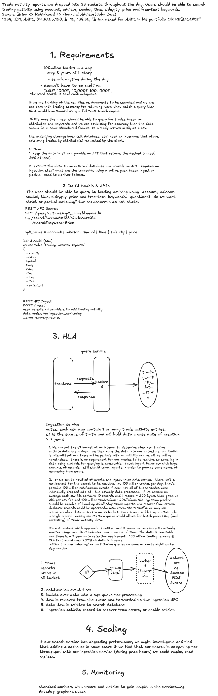
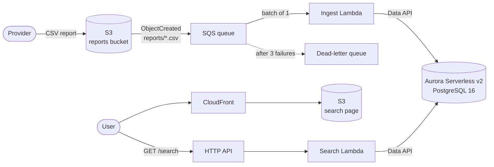

# Trade Search

Search trade activity across provider reports. Providers drop CSV reports into S3; each report is loaded into Aurora Serverless v2 PostgreSQL within seconds of arriving, and trades are searchable through a public `GET /search` API and a search page.



## Architecture



Four stacks, deployed in this order:

| Stack                    | Contains                                                                        |
| ------------------------ | ------------------------------------------------------------------------------- |
| `TradeSearchPersistence` | Aurora cluster, credentials secret, schema migrations (run on deploy)           |
| `TradeSearchIngestion`   | Reports bucket, S3 → SQS notification, ingest Lambda, dead-letter queue, alarms |
| `TradeSearchSearchApi`   | HTTP API, search Lambda, alarm                                                  |
| `TradeSearchWebsite`     | Search page bucket and CloudFront distribution                                  |

Stacks share values only through SSM parameters under `/trade-search/`, read at deploy time. There are no CloudFormation exports, so any stack can be updated or destroyed without unpicking cross-stack references.

See [docs/ARCHITECTURE.md](docs/ARCHITECTURE.md) for the ingest and search sequences, the schema and component responsibilities.

## Design choices

- **No VPC, no NAT gateway.** Lambdas run outside the VPC and reach Aurora through the RDS Data API, which keeps the idle cost close to zero.
- **Aurora scales to zero.** 0–4 ACUs, pausing after 5 idle minutes. The first request after a pause gets a `503` with `Retry-After`; the page retries on its own.
- **Exactly-once loading.** Every report line is claimed in `ingested_lines` (primary key: run + line number) in the same SQL statement that inserts its trade. A retried or re-delivered report never duplicates a trade.
- **Lineage.** Each report gets a row in `ingestion_runs` with its status, counts and the first 20 rejected lines. Re-uploading the same file is skipped; uploading different content under a key that already loaded trades is recorded as `failed` (`object overwritten`).
- **New York time in, UTC stored.** The date comes from the S3 key and the time from the CSV; both are read as `America/New_York` and stored as UTC, so DST is handled at the edge.
- **Keyset pagination.** Results come newest first, and `nextCursor` stays stable while new reports load.
- **Failure visibility.** A report that fails 3 times lands in the dead-letter queue and raises an alarm. Separate alarms fire on ingest or search Lambda errors.

## Prerequisites

- **Node.js 26+** and **pnpm 11** (`corepack enable` picks up the pinned version)
- **AWS CLI v2**, with credentials for the target account
- **Docker**, only for the integration tests
- An AWS region where the `nodejs26.x` Lambda runtime is available. The region and account come from your AWS profile (`CDK_DEFAULT_REGION` / `CDK_DEFAULT_ACCOUNT`); nothing in the repo pins them.

## Setup

```bash
pnpm install
pnpm test                 # unit + infrastructure tests
pnpm synth                # build the CloudFormation templates
```

## Deploy

```bash
pnpm cdk bootstrap        # once per account and region
pnpm cdk deploy --all
```

The first deploy takes 10–15 minutes while Aurora is created. Later deploys take a minute or two.

Then check the whole flow end to end:

```bash
pnpm smoke
```

It uploads a small synthetic report, waits until search returns all of its trades, then checks a filter, a rejected parameter and CORS. It takes a minute or two, longer if Aurora is paused.

## Load a report

Reports are CSV files without a header row, one trade per line:

```
account, advisor, symbol, HH:MM:SS(.mmm), B|S, qty, price, "notes"
```

- Put each report under `reports/YYYY-MM-DD/` and give it a `.csv` extension. Only `.csv` files under `reports/` are picked up; one without a `YYYY-MM-DD/` folder in its key is recorded as `failed` (`key has no YYYY-MM-DD date`).
- The date in the key and the times in the file are New York local time.
- `notes` is optional. `qty` is a whole number of 1 or more; `price` has up to 4 decimal places.
- Lines that don't parse are rejected and recorded; the rest of the report still loads.
- Reports are capped at 50 MB (about 640,000 lines, which load in about 2 minutes).

```bash
BUCKET=$(aws ssm get-parameter --name /trade-search/ingestion/reports-bucket-name \
  --query Parameter.Value --output text)

pnpm -s generate-csv 1000 > /tmp/trades.csv
aws s3 cp /tmp/trades.csv "s3://$BUCKET/reports/$(TZ=America/New_York date +%F)/trades.csv"
```

## Search

### Search page

```bash
aws cloudformation describe-stacks --stack-name TradeSearchWebsite \
  --query "Stacks[0].Outputs[?OutputKey=='SiteUrl'].OutputValue" --output text
```

Open that URL. The page reads and shows times in New York time and pages through results with **Load more**.

### API

```bash
API_URL=$(aws ssm get-parameter --name /trade-search/search-api/url \
  --query Parameter.Value --output text)

curl -s "$API_URL/search?account=1234&side=B&limit=5"
curl -s --get "$API_URL/search" --data-urlencode 'keyword=harvest OR trimming'
curl -s --get "$API_URL/search" --data-urlencode 'keyword="quarterly allocation"'
```

| Parameter                      | Match                                                                                                       |
| ------------------------------ | ----------------------------------------------------------------------------------------------------------- |
| `account`, `advisor`, `symbol` | exact, case-sensitive                                                                                       |
| `side`                         | `B` or `S`                                                                                                  |
| `from`, `to`                   | inclusive time range, ISO 8601 with a time zone (`2026-11-07T09:30:00-05:00`)                               |
| `qty_min`, `qty_max`           | whole numbers                                                                                               |
| `price_min`, `price_max`       | decimals                                                                                                    |
| `keyword`                      | words in the notes, matched by English stem; supports `"phrase"`, `OR` and `-exclude`; up to 200 characters |
| `limit`                        | 1–500, default 50                                                                                           |
| `cursor`                       | `nextCursor` from the previous page                                                                         |

Results come newest first as `{ items, nextCursor }`. Invalid parameters return `400` with `details`. While Aurora resumes from a pause the API returns `503` with `Retry-After: 5`. The API is public and throttled to 10 requests per second (burst 20).

## Operate

<details>
<summary>Check ingestion runs</summary>

```bash
CLUSTER_ARN=$(aws ssm get-parameter --name /trade-search/persistence/cluster-arn \
  --query Parameter.Value --output text)
SECRET_ARN=$(aws ssm get-parameter --name /trade-search/persistence/secret-arn \
  --query Parameter.Value --output text)

aws rds-data execute-statement --resource-arn "$CLUSTER_ARN" --secret-arn "$SECRET_ARN" \
  --database trades --format-records-as JSON \
  --sql 'select source_key, status, rows_ingested, rows_rejected, errors::text as errors
         from ingestion_runs order by id desc limit 5'
```

If the call fails with `DatabaseResumingException`, Aurora is waking up; run it again in 30 seconds.

</details>

<details>
<summary>A report didn't load</summary>

If no run appears, read the ingest Lambda's logs:

```bash
LOG_GROUP=$(aws cloudformation describe-stack-resources --stack-name TradeSearchIngestion \
  --query "StackResources[?ResourceType=='AWS::Logs::LogGroup'].PhysicalResourceId" --output text)
aws logs tail "$LOG_GROUP" --since 15m
```

A report that keeps failing moves to the dead-letter queue after 3 attempts and its alarm fires. The ingest error alarm fires only when the Lambda itself crashes or times out; a report that fails on its own shows up through the dead-letter queue alarm.

</details>

## Develop

```bash
pnpm test                              # unit + infrastructure
pnpm db:up && pnpm test:integration    # Postgres 16 in Docker on port 54329
pnpm db:down
pnpm typecheck && pnpm lint && pnpm format:check
```

The code talks to the database through a small `Db` interface with two adapters: the Data API in AWS and `pg` against the local Postgres, so the integration tests run the same SQL that runs in production.

```
src/
├── bin/                   # CDK app: stacks and deploy order
├── Infrastructure/        # stacks, SSM parameter names, Lambda defaults, alarms
├── lambda/                # handlers: sqs (ingest), api (search), custom-resources (migrate)
├── lib/                   # ingest, search, migrate, database adapters, trade model
└── tests/
web/                       # the search page (static HTML/CSS/JS)
scripts/                   # generate-csv, smoke
```

## Known limitations

- `symbol` matching is case-sensitive in the API (the page upper-cases it for you).
- Keyword search matches by English stem, so `rebalance` finds "REBALANCE quarterly allocation" but not "Rebalancing toward TSLA".
- `from` / `to` need a time and a time zone; a bare date returns `400`.
- The API has no authentication; it is protected only by throttling.

## Tear down

```bash
pnpm cdk destroy --all
```

Every resource is set to be deleted, including bucket contents and the database, so nothing is left behind.

## License

MIT. See [LICENSE](LICENSE).
