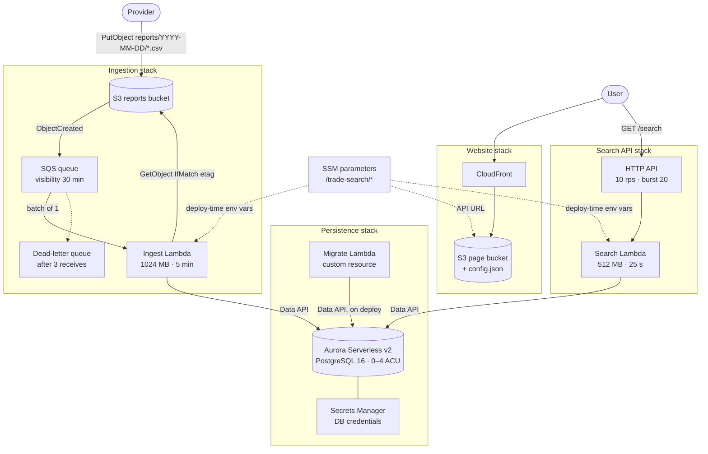
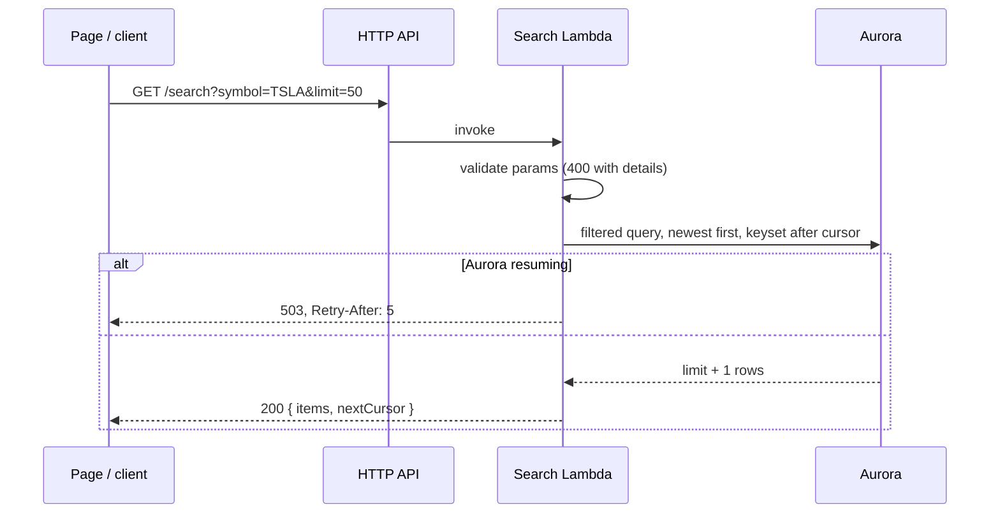

# Architecture

## Components



## Ingest a report

```mermaid
sequenceDiagram
    participant P as Provider
    participant S3 as S3
    participant Q as SQS
    participant L as Ingest Lambda
    participant DB as Aurora

    P->>S3: PutObject reports/2026-11-07/trades.csv
    S3->>Q: ObjectCreated (key, etag)
    Q->>L: one message
    L->>DB: find runs for key
    alt same etag already succeeded
        L-->>Q: skipped
    else different etag already loaded trades
        L->>DB: record failed run (object overwritten)
    else
        L->>DB: start run (processing)
        L->>S3: GetObject IfMatch etag (streamed)
        loop every 500 lines
            L->>DB: one statement: claim lines, insert trades, bump rows_ingested
        end
        L->>DB: complete run (counts, first 20 rejected lines)
    end
    Note over Q,L: A thrown error retries the message;<br/>3 failures move it to the DLQ and raise an alarm
```

## Search



## Stacks

| Stack                      | Resources                                               | Publishes to SSM                             |
| -------------------------- | ------------------------------------------------------- | -------------------------------------------- |
| **TradeSearchPersistence** | Aurora cluster, secret, migrate custom resource         | `cluster-arn`, `secret-arn`, `database-name` |
| **TradeSearchIngestion**   | Reports bucket, queue, DLQ, ingest Lambda, alarms       | `reports-bucket-name`                        |
| **TradeSearchSearchApi**   | HTTP API, search Lambda, alarm                          | `url`                                        |
| **TradeSearchWebsite**     | Page bucket, CloudFront, `config.json` with the API URL | —                                            |

## Lambda functions

| Function    | Trigger                                  | Purpose                                                            |
| ----------- | ---------------------------------------- | ------------------------------------------------------------------ |
| **Migrate** | CloudFormation custom resource           | Applies schema migrations, one statement per Data API call         |
| **Ingest**  | SQS (batch of 1, partial batch failures) | Streams a report, validates lines, saves trades in batches of 500  |
| **Search**  | HTTP API `GET /search`                   | Validates parameters, runs the query, encodes the next-page cursor |

All three functions run on arm64 outside the VPC, with logs kept for one month.

## Schema

| Table                      | Holds                                                                                   |
| -------------------------- | --------------------------------------------------------------------------------------- |
| `trading_activity_reports` | One row per trade; `traded_at` in UTC; generated `notes_tsv` for keyword search         |
| `ingestion_runs`           | One row per report version (`source_key`, `etag`): status, counts, rejected-line errors |
| `ingested_lines`           | `(run_id, source_line)` → `trade_id`; the claim that makes loading exactly-once         |

Indexes: `(account | advisor | symbol, traded_at desc, id desc)`, `(traded_at desc, id desc)` for keyset pages, and GIN on `notes_tsv`.

## Technology

| Technology                                     | Use                                                       |
| ---------------------------------------------- | --------------------------------------------------------- |
| AWS CDK 2, TypeScript                          | Infrastructure                                            |
| Node.js 26 (`nodejs26.x`, arm64)               | Lambda runtime and tooling; `Temporal` for New York → UTC |
| Aurora Serverless v2 PostgreSQL 16 + Data API  | Storage and full-text search                              |
| API Gateway HTTP API                           | Public search endpoint                                    |
| S3 + CloudFront                                | Reports bucket and the search page                        |
| Vitest, `aws-sdk-client-mock`, Docker Postgres | Unit, infrastructure and integration tests                |
